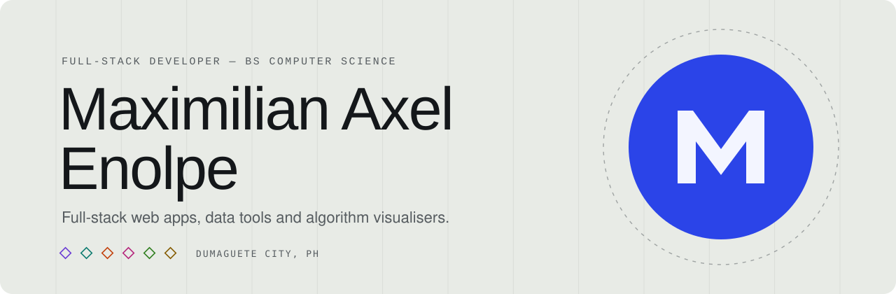

<picture>
  <source media="(prefers-color-scheme: dark)" srcset=".github/assets/banner-dark.svg">
  
</picture>

<p align="center">
  
  
  
  
</p>

<p align="center">
  <a href="https://github.com/maxxqcty"></a>
  <a href="https://www.linkedin.com/in/maximilian-axel-enolpe-90b755266/"></a>
</p>

## 👋 Hi, I'm Maximilian

I'm a computer science student at **Negros Oriental State University** in Dumaguete City, Philippines. I like building software end to end: a clear data model, a fast API, and an interface people can use without instructions.

This repository is my personal portfolio: a single web page that introduces me, my projects and what I enjoy outside of code.

## ✨ What's on the page

| | Section | What you'll find |
|:-:|---|---|
| 🧭 | **Intro** | Who I am, at a glance |
| 🛠️ | **Selected work** | Five featured projects, each with a live animated preview |
| 🙋 | **Profile** | A short bio and the tools I work with |
| 📊 | **Languages** | How my code on GitHub splits across languages |
| 🎓 | **Education & certificates** | School, organisations and certificates |
| 🎬 | **Off the clock** | Favourite films and the music I have on repeat |
| ✉️ | **Contact** | Email, profiles and my local time |

## 🚀 Featured projects

| Project | What it does | Built with |
|---|---|---|
| [**OpenSeat**](https://github.com/maxxqcty/openseat) | Booking and waitlist app that fills cancelled seats automatically | FastAPI · React · Postgres |
| [**Scholar PDF Downloader**](https://github.com/maxxqcty/Semantic-Scholar-PDF-Downloader) | Searches Semantic Scholar and saves open-access papers, with an Excel list of details | Python |
| [**BST Visualizer**](https://maxxqcty.github.io/BST-Visualizer/) ▶️ | Animates how a binary search tree inserts and searches | JavaScript · D3 |
| [**AVL Tree Visualizer**](https://maxxqcty.github.io/AVL-Tree-Visualizer/) ▶️ | Shows a self-balancing tree's rotations live | JavaScript |
| [**School System CRUD**](https://github.com/maxxqcty/School-System-Crud) | Student records with login and image uploads | PHP · MySQL · Bootstrap |

▶️ = live demo you can open in the browser

## 🎨 Little details

- 🌗 **Light and dark mode**: follows your system, with a toggle in the corner
- 🫧 **Liquid cursor**: a soft blob that follows your mouse and reacts to what it's over
- 📏 **Scroll ruler**: a measuring rail on the right edge, with section names that fly into place
- 📐 **Drafting-table background**: grid lines and sketches that draw themselves as you scroll
- 📱 **Works on phones**: the layout adapts to any screen size

## 💻 Try it yourself

No installation needed. Download the project and open `index.html` in your browser.

To view it as it runs online, start a small local server in the project folder:

```sh
npx serve .
```

## 📚 Want the technical details?

The [development guide](docs/DEVELOPMENT.md) explains how the files are organised and how to update projects, colours, the portrait, films and music.

---

<p align="center">Made with care in Dumaguete City 🇵🇭</p>
